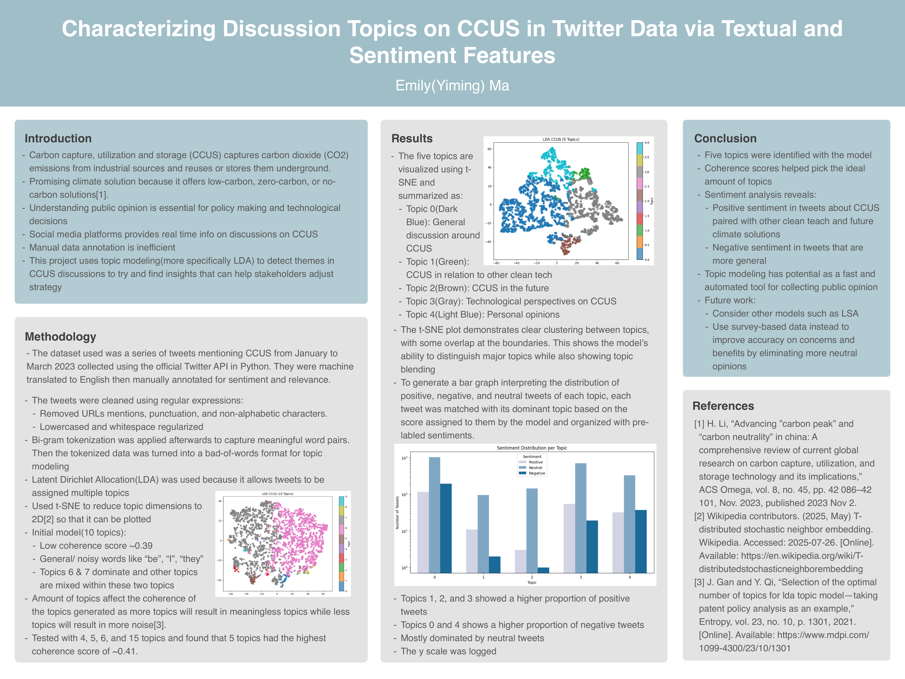
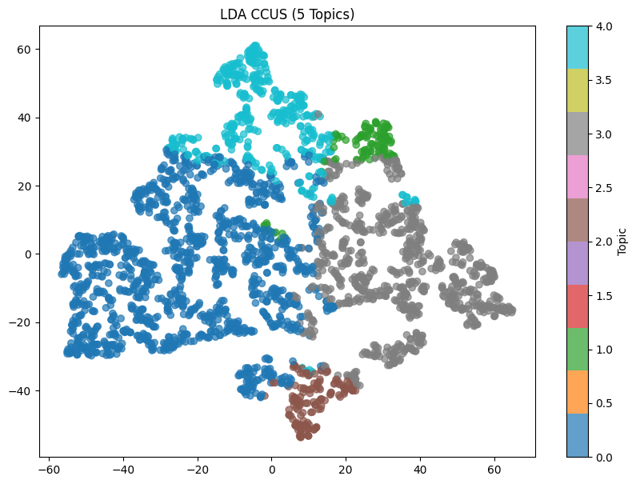
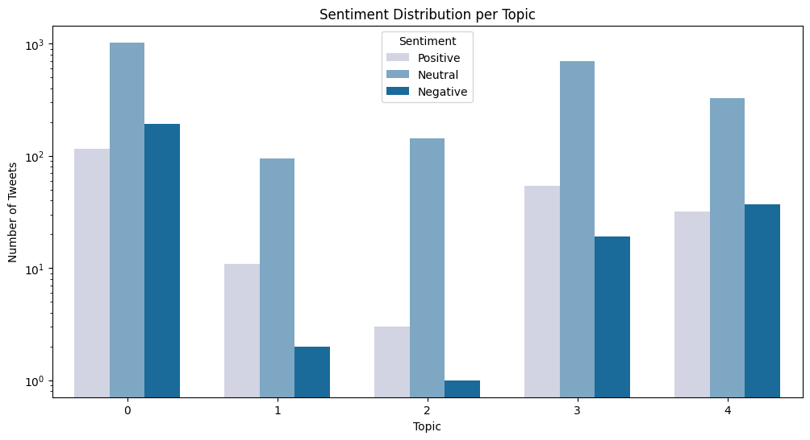

# Characterizing Discussion Topics on CCUS in Twitter Data

Using topic modeling (LDA) and sentiment analysis to find out what people discuss about **carbon capture, utilization and storage (CCUS)** on Twitter, and how they feel about it.

**Published:** [*Characterizing Discussion Topics on CCUS in Twitter Data via Textual and Sentiment Features*](https://www.curieuxacademicjournal.com/_files/ugd/99711c_f7a0283271614b78b49164adbc9d7143.pdf), Curieux Academic Journal, Issue 55 (2025)



## The Problem
CCUS captures CO₂ from industrial sources and reuses it or stores it underground, which makes it a promising climate solution. Understanding public opinion on it matters for policy and technology decisions. Social media offers real-time opinions, but reading and labeling thousands of posts by hand is slow. This project tests whether **topic modeling can automatically surface the main themes** in CCUS discussions, so stakeholders can understand public opinion faster.

## Dataset
- Tweets mentioning CCUS from **January to March 2023**, collected with the official Twitter API
- Machine-translated to English, then manually annotated for sentiment (positive / neutral / negative) and relevance
- **3,030 tweets in 31 languages**, reduced to **2,769 tweets** after removing duplicates and tweets marked "not related"

## How It Works

**1. Exploratory data analysis** (`eda.ipynb`)
- Filled missing labels, removed 65 duplicate tweets, and filtered out unrelated tweets
- Plotted sentiment, language, and the benefits and concerns mentioned

**2. Text preprocessing** (`ccusm.ipynb`)
- Cleaned tweets with regular expressions: removed URLs, @mentions, punctuation, and non-alphabetic characters, then lowercased and normalized whitespace
- Built **bigrams** to capture meaningful word pairs, lemmatized with spaCy, and converted to a bag-of-words corpus with gensim

**3. Topic modeling with LDA**
Latent Dirichlet Allocation was chosen because it lets one tweet belong to several topics. I compared models by **coherence score**:

| Number of topics | Coherence score |
|:---:|:---:|
| 10 | 0.400 |
| **5 (selected)** | **0.409** |
| 15 | 0.401 |

The 10-topic model was noisy: generic words like "be," "I," and "they" dominated, and two topics absorbed most of the others. With more topics they become meaningless; with fewer, they get noisier. **5 topics** gave the best coherence.

**4. Visualization and sentiment**
- Reduced each tweet's topic mix to 2D with **t-SNE** to see how well the topics separate
- Matched each tweet to its dominant topic and compared that against its sentiment label

## Results



| Topic | Theme |
|:---:|-------|
| 0 | General discussion around CCUS |
| 1 | CCUS in relation to other clean tech |
| 2 | CCUS in the future |
| 3 | Technological perspectives on CCUS |
| 4 | Personal opinions |

The t-SNE plot shows **clear clusters** with some overlap at the edges, so the model separates the major topics while still showing where they blend.



- Most tweets are **neutral** across all topics (note the log scale).
- **Topics 1, 2, and 3** (clean tech, the future, technology) have a higher share of **positive** tweets.
- **Topics 0 and 4** (general discussion, personal opinions) have a higher share of **negative** tweets.

## Key Finding
People are more positive about CCUS when it is discussed **alongside other clean tech and as a future climate solution**, and more negative in general or personal discussion. Topic modeling shows real potential as a **fast, automated way to gauge public opinion**.

**Future work:** try other models such as LSA, and use survey-based data to better capture specific concerns and benefits.

## Tech Used
Python · pandas · NLTK · spaCy · gensim (LDA) · scikit-learn (t-SNE) · matplotlib · seaborn · WordCloud · Google Colab

## How to Run
The notebooks were written in Google Colab.
1. Open `eda.ipynb` in Colab, upload the tweet dataset CSV, and update the `filename` path. Running it creates `ccus_clean.csv`.
2. Open `ccusm.ipynb`, point it to `ccus_clean.csv`, and run all cells.

Required packages:
```bash
pip install pandas matplotlib seaborn nltk spacy gensim scikit-learn wordcloud
python -m spacy download en_core_web_sm
```

## References
1. H. Li, "Advancing 'carbon peak' and 'carbon neutrality' in China: A comprehensive review of current global research on carbon capture, utilization, and storage technology and its implications," *ACS Omega*, vol. 8, no. 45, pp. 42086–42101, 2023.
2. "t-distributed stochastic neighbor embedding," Wikipedia, 2025.
3. J. Gan and Y. Qi, "Selection of the optimal number of topics for LDA topic model — taking patent policy analysis as an example," *Entropy*, vol. 23, no. 10, p. 1301, 2021.

## Author
Emily (Yiming) Ma · [LinkedIn](YOUR_LINKEDIN_URL_HERE)
